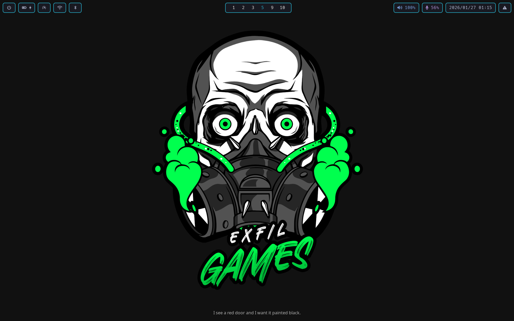

# .files

Personal dotfiles for an Arch + Hyprland workstation. Managed by
[krypt](https://github.com/kryptic-sh/krypt) — every install / update /
template-seed / hook is declared in `.krypt.toml` instead of a tangle of bash.



## Philosophy

Sleek modern Wayland setup. Hyprland tiling, Fish shell, Neovim + LazyVim,
TokyoNight throughout. Config is data: `.krypt.toml` and its included files
describe what lives where, what packages to install, and what commands the user
can invoke. krypt does the work; bash scripts only exist when the logic is
genuinely shell-shaped.

## Prerequisites

- **OS**: Arch Linux is the primary target. `.krypt/deps.toml` also maps
  packages for Debian/Ubuntu (apt), Fedora (dnf), macOS (Homebrew) and Windows
  (scoop, with PowerShell 7 and uutils coreutils standing in for fish), and CI
  resolves every package and installs the `core` group on each of them. Known
  gaps are in `docs/backlog.md`.
- **Display server**: Wayland (Hyprland). X11 unsupported.
- **CPU/GPU**: x86_64, any modern Wayland-capable GPU (tested on AMD).
- **CLI bootstrap**: `git`, `bash`, `curl`. Everything else `krypt setup`
  installs.

### Runtime assets (installed via `krypt deps`)

- **Font**: [Hack Nerd Font](https://www.nerdfonts.com/) (`ttf-hack-nerd`).
- **Cursor**: `Breeze_Light` (`breeze`).
- **GTK theme**: `adw-gtk-theme`.
- **Icon theme**: system default.

## Core Components

- **WM**: [Hyprland](https://hyprland.org/) — Wayland tiling compositor.
- **Shell**: [Fish](https://fishshell.com/).
- **Terminal**: [Alacritty](https://alacritty.org/).
- **Editor**: [Neovim](https://neovim.io/) +
  [LazyVim](https://www.lazyvim.org/).
- **Bar**: [lyr](https://github.com/kryptic-sh/lyr), with its own Wi-Fi,
  Bluetooth, audio and power menus.
- **Launcher**: [pikr](https://github.com/kryptic-sh/pikr) — vim-like fuzzy
  picker.
- **Notifications**: lyr, which is the notification daemon and keeps the history
  under its clock panel's calendar.
- **File Manager**: [Nautilus](https://help.gnome.org/users/nautilus/).
- **Browser**: [Chromium](https://www.chromium.org/).
- **Screenshot**: [Grimblast](https://github.com/hyprwm/contrib).
- **System monitor**: [btop](https://github.com/aristocratos/btop).
- **Prompt**: [Starship](https://starship.rs/).

## Install

Setting up a new Arch machine from scratch? Follow
[Fresh Arch install](#fresh-arch-install) instead: it covers the base system
these dotfiles expect, bootstrapping paru, and the system configs in `.root/`,
and includes the steps below.

### 1. Install krypt

| Platform | Command                                                                                             |
| -------- | --------------------------------------------------------------------------------------------------- |
| Arch     | `paru -S krypt-bin`                                                                                 |
| macOS    | `brew trust --tap kryptic-sh/tap` then `brew install kryptic-sh/tap/krypt`                          |
| Windows  | `scoop bucket add kryptic-sh https://github.com/kryptic-sh/scoop-bucket` then `scoop install krypt` |
| Any      | `cargo install krypt-cli`                                                                           |
| Manual   | grab a binary from [GH Releases](https://github.com/kryptic-sh/krypt/releases)                      |

On Windows, install [scoop](https://scoop.sh) first, in PowerShell as your own
user (no admin): `irm get.scoop.sh | iex`. `krypt deps` installs every Windows
package through it, per-user under `~\scoop`, so nothing asks for elevation.

The `.gitconfig` sets `core.symlinks = true`, which on Windows needs Developer
Mode so that git can create symlinks; without it, cloning or checking out a repo
that contains one fails with `unable to create symlink ... Permission denied`.
`krypt setup` and `krypt update` turn it on (`krypt system devmode`, one UAC
prompt, only when it is off). Git for Windows also writes
`core.symlinks = false` into the `.git/config` of each repo it clones where
symlinks were not allowed, which overrides the global setting there.

Verify: `krypt --version` should report the `krypt_min` in `.krypt.toml` or
newer.

### 2. Clone + link

```sh
krypt init https://github.com/mxaddict/dotfiles
krypt deps     # install this OS's packages
krypt setup    # interactive: git identity, Hyprland defaults, keyboard layout
krypt link     # copy this platform's files into place
```

`krypt setup` runs the `[prompts.*]` blocks in `.krypt.toml` and writes the
answers to the `[[template]]` destinations; sections whose templates belong to
another platform (the Hyprland ones outside Linux) are skipped. `krypt link`
deploys only the entries whose `platform` matches this OS.

On Arch, `krypt setup` also installs the system configs in `.root/` into `/`
(`krypt system root`); see [Fresh Arch install](#fresh-arch-install) for what
that needs and does.

### 3. Daily updates

```sh
krypt update          # pull repo, relink, run post-update hooks
krypt update --dry-run         # show plan, change nothing
krypt update --skip-hooks      # skip nvim/fisher/dconf/bat/etc. plugin syncs
```

Hooks declared in `.krypt.toml` (`[[hook]] when = "post-update"`) cover:

- mkdir essential `$HOME` dirs + `~/.local/log`
- fisher / nvim Lazy plugin syncs
- bat cache rebuild, tldr cache refresh
- dconf load from `dconf/user.ini`
- `hyprctl reload` (gated on hyprland running)
- Windows Developer Mode (`krypt system devmode`), which `krypt setup` also runs
  as a `post-setup` hook
- the kryptic-sh tools (`krypt deps --group kryptic`: hjkl, hrdr, gpur, ...),
  also a `post-setup` hook; every other deps group is installed only by running
  `krypt deps`
- the claude, codex and opencode CLIs (`krypt system agents`), also a
  `post-setup` hook: each is installed by its own script and then updates
  itself, claude and codex in `~/.local/bin` and opencode in `~/.opencode/bin`,
  which the fish and PowerShell configs put on `PATH`

### Forking

`krypt init` accepts any HTTPS / SSH git URL. Point it at your fork.

## Fresh Arch install

The steps from a newly installed Arch system to a working desktop. The system
configs in `.root/` replace files in `/etc`, so this assumes a machine set up
for them; read step 1 before installing Arch.

### 1. Base system

Install Arch with [archinstall](https://wiki.archlinux.org/title/Archinstall) or
by hand, with:

- **UEFI, the ESP mounted at `/boot`, and systemd-boot** (`bootctl install`).
  `.root/`'s mkinitcpio preset builds a unified kernel image (UKI) into
  `/boot/EFI/Linux` and no separate initramfs, and systemd-boot finds UKIs there
  without a loader entry. GRUB, or an ESP mounted elsewhere, will not boot it;
  `krypt system root` stops before changing anything when `/boot/EFI` is
  missing.
- **The `linux` kernel.** The preset is for it (`/boot/vmlinuz-linux`).
- **A user in `wheel` with sudo**, and a network connection for the first boot.
  The setup installs NetworkManager and enables it.
- **Optional: LUKS.** `.root/`'s `mkinitcpio.conf` uses the systemd hooks with
  `sd-encrypt`, so an encrypted root is unlocked from the kernel command line
  (`rd.luks.name=…`).

The UKI embeds a kernel command line: `/etc/kernel/cmdline` or
`/etc/cmdline.d/*.conf` when present, else the one the machine booted with
(`/proc/cmdline`). On a fresh install the booted one is right, so there is
nothing to do; to change it later (`root=`, `rd.luks.name=`, `quiet`), write it
to `/etc/kernel/cmdline` and run `sudo mkinitcpio -P`.

### 2. paru

`krypt deps` installs AUR packages (`kanata`, the kryptic-sh tools) through
paru, so build paru first, as your user:

```sh
sudo pacman -S --needed base-devel git rustup
rustup default stable
git clone https://aur.archlinux.org/paru.git /tmp/paru
cd /tmp/paru && makepkg -si
```

### 3. krypt and the dotfiles

```sh
paru -S krypt-bin
krypt init https://github.com/mxaddict/dotfiles
krypt deps     # every package group, through paru
krypt setup    # prompts, then the post-setup hooks below
krypt link     # copy the dotfiles into place
```

`krypt --version` must be at least the `krypt_min` in `.krypt.toml`: older krypt
runs paru under sudo, and paru refuses to build AUR packages as root.

`krypt setup` ends with its post-setup hooks. On Arch, one runs
`krypt system root`, which asks for your sudo password once and:

1. installs the `root` deps group: what the `.root/` configs need or call;
2. copies each file in `.root/` to the same path under `/`, skipping the ones
   that already match and keeping the first version it replaces as
   `<file>.orig`;
3. rebuilds the UKI when `mkinitcpio.conf`, the preset or `vconsole.conf`
   changed;
4. enables ly on tty2 (replacing any other display manager), kanata,
   NetworkManager, bluetooth, cups, avahi, ufw, power-profiles-daemon and the
   `power-check` timer that picks a power profile from the battery level;
5. turns the firewall on: ufw drops incoming traffic except SSH (`22/tcp`) and
   allows outgoing. Rules a machine already has stay, so on a fresh install SSH
   is the only open port.

`krypt setup` also installs the kryptic-sh tools. lyr (the bar) and pikr (the
launcher) render with Vulkan, so that group brings mesa's Vulkan drivers for
AMD, Intel and NVIDIA (nouveau), plus lavapipe as a CPU fallback.

### 4. First boot

Reboot. systemd-boot lists the UKI as Arch Linux, and the machine boots to ly on
tty2. Once it does, delete the loader entry the base install made
(`/boot/loader/entries/*.conf`) and its `/boot/initramfs-linux*.img`: nothing
rebuilds that initramfs any more, so the entry breaks at the next kernel update.

### 5. Afterwards

- **Hibernation.** `logind.conf` and `sleep.conf` use suspend-then-hibernate,
  which needs swap at least the size of RAM and the resume parameters in the
  UKI. `krypt system swap` creates `/swap`, writes those parameters to
  `/etc/cmdline.d/root.conf` and rebuilds the UKI.
- **Microcode.** Install `intel-ucode` or `amd-ucode` for your CPU and run
  `sudo mkinitcpio -P`; the `microcode` hook adds it to the UKI.
- **Firewall.** Open another port with `sudo ufw allow <port>`;
  `sudo ufw status` lists what is open.
- **NVIDIA's driver.** Install `nvidia-open` and `nvidia-utils`, which brings
  its Vulkan driver; mesa's nouveau one only drives the open nouveau kernel
  driver.
- **Changes to `.root/`.** `krypt update` does not reapply it, because it would
  overwrite deliberate local edits in `/etc`. Run `krypt system root` after a
  change you want.

## Migration from the old stow-bash version

If you used the `~/.files` clone before krypt landed (`.update` / `.setup` bash
scripts), `$HOME` is full of stow symlinks into that clone. Keep them and krypt
writes through them into the clone's tracked files, which then show up there as
uncommitted changes. Replace them with real files and retire the clone:

1. Install krypt 0.4.3 or newer (see [Install](#1-install-krypt)). Older
   versions skip every file that already matches the repo as a conflict.
2. Bring the clone level with the repo: commit and push anything you changed in
   it, then `git -C ~/.files pull`. Every file you move home then matches the
   repo, so krypt takes it over as already deployed.
3. List every symlink into the clone, and read the list before going on:

   ```bash
   find ~ -xdev \( -path ~/.files -o -path ~/.cache \) -prune -o -type l -print |
     while IFS= read -r link; do
       target=$(readlink -f "$link")
       case "$target" in "$HOME"/.files/*) printf '%s\t%s\n' "$link" "$target" ;; esac
     done > ~/files-links.tsv
   ```

4. Swap each link for the file or directory it points at. A link whose target is
   gone points at nothing, so it is only removed:

   ```bash
   while IFS=$'\t' read -r link target; do
     rm "$link"
     if [ -e "$target" ]; then mv "$target" "$link"; fi
   done < ~/files-links.tsv
   ```

5. Check what is left in the clone that git does not have, since deleting the
   clone loses it. The moved files show as deleted, which is expected. Move
   anything you want to keep out of the clone first; caches and old logs can go.

   ```bash
   git -C ~/.files status --short --ignored --untracked-files=all | grep -E '^(\?\?|!!)'
   git -C ~/.files stash list
   git -C ~/.files log --branches --not --remotes --oneline
   ```

6. Delete the clone (`rm -rf ~/.files`) and `~/files-links.tsv`.
7. `krypt init https://github.com/mxaddict/dotfiles` if krypt has no repo yet,
   then `krypt update`. It replaces the old `.update` chain and reloads Hyprland
   if it is running.
8. `krypt diff` lists anything still out of step with the repo.

Your machine's own files, the `[[template]]` destinations such as
`~/.gitconfig.local` and `~/.config/hypr/monitors.lua`, differ from the repo on
purpose: krypt leaves them alone and counts them in "conflicts skipped". The old
`~/.config/hypr/{apps,input,monitors}.conf` are not read any more, since
`hyprland.lua` loads `apps.lua`, `input.lua` and `monitors.lua` instead; move
your settings across before deleting them.

Bash scripts in `.local/bin/.*` (e.g. `.menu-power`, `.kanata`) **stay on disk**
— krypt invokes them via `[[command]]` entries. They get full `shellcheck` +
`ft=bash` treatment instead of being inlined into TOML strings.

The Hyprland keybinds in `hyprland.lua` now invoke `krypt menu <name>` instead
of the scripts directly. lyr's modules open lyr's own menus.

## Templates (user-specific, gitignored)

`krypt setup` seeds these from `*.template.*` files on first run. Re-running is
safe — krypt only seeds files that don't exist yet.

| Template (repo)                        | Destination                     | Purpose                         |
| -------------------------------------- | ------------------------------- | ------------------------------- |
| `.gitconfig.local.template`            | `~/.gitconfig.local`            | Name, email, GPG                |
| `.config/hypr/apps.template.lua`       | `~/.config/hypr/apps.lua`       | Terminal, browser, file manager |
| `.config/hypr/input.template.lua`      | `~/.config/hypr/input.lua`      | Keyboard layout                 |
| `.config/hypr/monitors.template.lua`   | `~/.config/hypr/monitors.lua`   | Monitor positions               |
| `.config/hypr/hyprpaper.template.conf` | `~/.config/hypr/hyprpaper.conf` | Wallpaper                       |

### Files to edit per-machine

1. `~/.gitconfig.local` — identity + signing.
2. `~/.config/hypr/monitors.lua` — `hyprctl monitors` to discover names.
3. `~/.config/hypr/apps.lua` — terminal / browser / file manager defaults.
4. `~/.config/hypr/input.lua` — change `kb_layout` if not US.

Optional:

- `~/.config/hypr/workspaces.lua` — pin workspaces to monitors.
- `~/.config/hypr/hyprpaper.conf` — wallpaper path.
- `.codex/config.toml`, `.config/opencode/opencode.json` — Ollama host.

## Keybinding cheatsheet (Hyprland)

`$mod` = **Super** (Windows key). Every menu binding invokes `krypt menu <name>`
or another krypt subcommand — see `.krypt/commands.toml` for the underlying
step. `$mod + /` opens a cheatsheet of these binds, read each time it opens:
Hyprland's running binds from `hyprctl binds` (tagged `Hyprland`), and tmxr's
binds in its prefix and root tables and the copy-mode table `mode-keys` selects:
its built-in defaults, with `~/.config/tmxr/config.toml` over them when there is
one (tagged `tmxr`, or `tmxr copy-mode`). Descriptions come from each bind's
`description` / `note`.

### Apps & menus

| Bind                         | krypt invocation      | Action                                     |
| ---------------------------- | --------------------- | ------------------------------------------ |
| `$mod + return` / `c`        | —                     | Alacritty                                  |
| `$mod + b`                   | —                     | Browser                                    |
| `$mod + e`                   | —                     | Nautilus                                   |
| `$mod + space`               | `krypt menu apps`     | App launcher                               |
| `$mod + r`                   | `krypt menu calc`     | qalculate picker                           |
| `$mod + .`                   | `krypt menu emoji`    | Emoji picker                               |
| `$mod + w`                   | —                     | lyr Wi-Fi menu                             |
| `$mod + a`                   | —                     | lyr audio menu                             |
| `$mod + u`                   | —                     | lyr Bluetooth menu                         |
| `$mod + t`                   | `krypt menu time`     | Timezone picker                            |
| `$mod + escape`              | `krypt menu top`      | btop                                       |
| `$mod + shift + m`           | `krypt menu power`    | Power picker                               |
| `$mod + /`                   | `krypt menu keys`     | Keybinding cheatsheet                      |
| `$mod + n` / `+S+n` / `+A+n` | —                     | lyr notifications / do not disturb / clear |
| `ctrl + shift + k`           | `krypt kanata toggle` | Toggle kanata.service                      |

### Autofill (pass + wtype)

| Bind              | krypt invocation              |
| ----------------- | ----------------------------- |
| `$mod + ctrl + j` | `krypt menu autofill -- auth` |
| `$mod + ctrl + k` | `krypt menu autofill -- user` |
| `$mod + ctrl + l` | `krypt menu autofill -- pass` |
| `$mod + ctrl + ;` | `krypt menu autofill -- otp`  |

### Screen

| Bind                 | Action                        |
| -------------------- | ----------------------------- |
| `$mod + p` / `Print` | Screenshot region (grimblast) |
| `$mod + shift + p`   | Screen record (kooha)         |
| `$mod + ctrl + p`    | Color picker                  |
| `$mod + m`           | Lock screen                   |

### Window management

| Bind                     | Action                   |
| ------------------------ | ------------------------ |
| `$mod + q`               | Close active             |
| `$mod + f`               | Maximize                 |
| `$mod + shift + f`       | True fullscreen          |
| `$mod + v`               | Toggle floating          |
| `$mod + s`               | Toggle split direction   |
| `$mod + h/j/k/l`         | Focus left/down/up/right |
| `$mod + shift + h/j/k/l` | Move window              |
| `ctrl + arrows`          | Resize                   |
| `$mod + tab`             | Cycle windows            |

### Workspaces

| Bind                  | Action                    |
| --------------------- | ------------------------- |
| `$mod + 1..9,0`       | Switch to workspace 1..10 |
| `$mod + shift + 1..0` | Move window to workspace  |
| `$mod + LMB drag`     | Move window               |
| `$mod + RMB drag`     | Resize window             |

### Audio / brightness

`XF86Audio*` and `XF86MonBrightness*` wired via `swayosd-client`.
`$mod + up/down/left/right` doubles as volume +/-/mute. Add `shift` for mic.

## `.krypt.toml` layout

Top-level `.krypt.toml` declares `[meta]`, `[paths]`, `[prompts.*]`, and
`[[template]]` entries, and includes three sub-files:

| File                   | Holds                                                                  |
| ---------------------- | ---------------------------------------------------------------------- |
| `.krypt/links.toml`    | `[[link]]` rules: which repo files are copied where in `$HOME`         |
| `.krypt/deps.toml`     | `[[deps]]` groups: cross-distro package mappings                       |
| `.krypt/commands.toml` | `[[command]] group=… name=…` — every `krypt <group> <name>` invocation |

`[[hook]] when = "post-update"` entries live in the top-level `.krypt.toml`.

To add a new menu (e.g. `krypt menu screenshot`):

1. Add `[[command]] group = "menu" name = "screenshot" steps = […]` to
   `.krypt/commands.toml`.
2. (Optional) Add the Hyprland bind in `.config/hypr/hyprland.lua`:
   `hl.bind("SUPER + SHIFT + S", hl.dsp.exec_cmd("krypt menu screenshot"), { description = "Screenshot menu" })`.
   Give every bind a `description` — `krypt menu keys` (`$mod + /`) lists them
   as the live cheatsheet.
3. `krypt validate` — fail fast on config errors.

## Convention: dotfile-prefixed scripts

Scripts in `.local/bin/` are intentionally named with a leading `.` (e.g.
`.menu-apps`, `.kanata`). Hidden from `ls` but show with `ls -A`. Keeps the
user's interactive PATH visually clean while still being invocable from
`.krypt.toml`.

## Contributing

See [CONTRIBUTING.md](CONTRIBUTING.md) for commit style, naming, lint.

## License

MIT — see [LICENSE](LICENSE).
